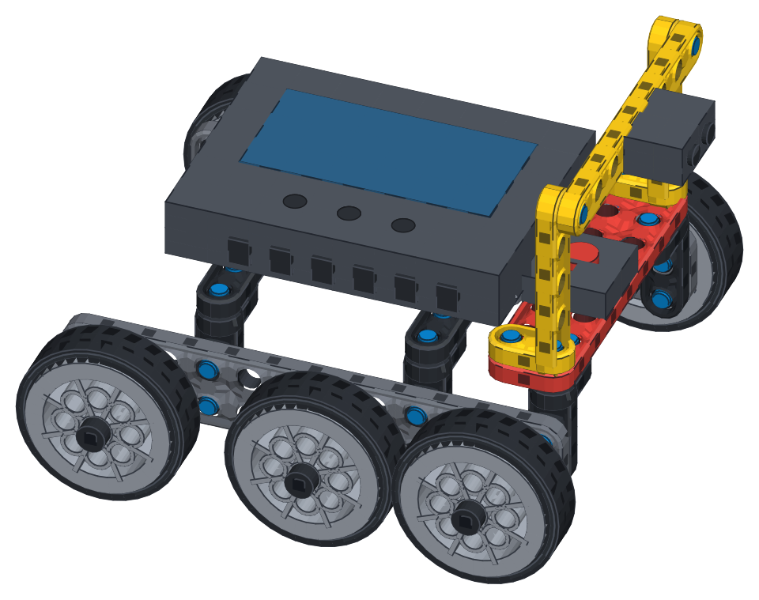

# IQDraw

[](https://github.com/elijahcroft/iqdraw/actions/workflows/tests.yml)
[](LICENSE)
[](https://www.python.org/downloads/)

Create printable, step-by-step VEX IQ (2nd generation) build instructions from
a small, readable Python specification.

**[Explore five finished builds and their printable booklets &rarr;](https://elijahcroft.github.io/iqdraw/)**

[](https://elijahcroft.github.io/iqdraw/#examples)

*The 80-part [survey rover](examples/survey-rover.py), rendered directly from
its build specification with IQDraw's redistributable procedural geometry.*

You describe a build as a list of parts at hole coordinates. It renders
isometric step-by-step diagrams and wraps them in a printable booklet with a
parts callout on every step — the shape of a real VEX build guide.

A build too big for one flat list is described as **modules** placed into a
frame — written once, placed twice, mirrored for the far side — and its
booklet is divided into named **sections**. See
[Building something bigger](#building-something-bigger).

IQDraw works offline with Python 3.9 or newer. Its renderer is
standard-library-only; the desktop installation includes CustomTkinter.

## Desktop app

Prefer buttons to terminal commands? Launch **IQDraw Studio** after installing:

```bash
iqdraw-gui
```

You can also use `iqdraw --gui`, or open a build immediately with
`iqdraw-gui examples/gear-train.py`. The desktop app includes bundled examples,
recent projects, step and inventory review, validation results, remembered
drawing options, source auto-reload, keyboard shortcuts, and HTML/SVG/PNG
output. CAD models are selected by default, with an automatic precision-model
fallback for any part that has no local CAD mesh. Rendering stays responsive
in the background and uses the same tested path as the CLI.

It uses CustomTkinter for a modern, system-aware desktop interface. The normal
IQDraw installation includes it automatically; some minimal Linux systems may
also need their OS's `python3-tk` package. Build specs are Python programs, so
only open files you trust. Studio inspects a spec in a short-lived helper
process to keep its state out of the GUI, but that is not a security sandbox.

Homebrew installs Tk separately from Python. If a Homebrew-based environment
reports `No module named '_tkinter'`, install the matching formula—for example,
`brew install python-tk@3.14` for Homebrew Python 3.14—then try `iqdraw-gui`
again.

## Quick start

```bash
git clone https://github.com/elijahcroft/iqdraw.git
cd iqdraw
python3 -m pip install -e .
iqdraw examples/gear-train.py -o out/gear-train.html
```

Open `out/gear-train.html` in a browser; use Print to make a paper booklet or
PDF. To start your own build without copying boilerplate:

```bash
iqdraw --new examples/my-build.py
iqdraw examples/my-build.py
```

Writing builds with an AI agent, or want the short version? [AGENTS.md](AGENTS.md) is the loop, the orientations and the checks on one page.

The starter file is intentionally short. Edit its steps, refresh the generated
HTML, and use the [coordinate model](#the-coordinate-model) when adding parts.
The complete [pinned frame](examples/pinned-frame.py),
[gear train](examples/gear-train.py), [drive base](examples/drive-base.py), and
[grabber arm](examples/grabber-arm.py) show progressively larger builds. The
[six-wheel survey rover](examples/survey-rover.py) is the flagship example:
24 steps, 80 parts, mirrored wheel modules, coloured structure, electronics,
and a deliberate final camera change across seven named sections.

| option | what it does |
|---|---|
| `-o FILE` | where the HTML goes. Without it, next to the spec |
| `--svg-dir DIR` | also write one SVG per step |
| `--png` | also rasterise each step (needs `rsvg-convert`) |
| `--no-hero` | drop the finished-model image from the cover |
| `--new FILE` | create a starter build without overwriting an existing file |
| `--detail cad` | prefer local high-detail CAD meshes when available, with automatic procedural fallback (default) |
| `--detail simple` | always use the included, independently drawn procedural geometry for smaller files |
| `--context-detail simple` | plainer geometry for the parts *already built*; the step's own parts keep full detail |
| `--check-only` | run the checks and report, drawing nothing |
| `--strict` | treat anything the checks find as an error |
| `--no-check` | skip the checks |
| `--sheet FILE` | every step and four views of the finished model on one captioned page, `.png` or `.svg` |
| `--views DIR` | the finished model from the top, bottom, each side and the corner, with hole-number rulers |
| `--parts`, `--part NAME` | every part family, or one part's envelope and holes in its own coordinates, as JSON — no spec needed |
| `--inspect` | print the finished build as JSON — parts, holes, joints, problems — drawing nothing. `--at X,Y,Z` narrows it to one point |

You can also run `python3 -m iqdraw` anywhere you would use the `iqdraw`
command. Contributors should start with [CONTRIBUTING.md](CONTRIBUTING.md);
`./run-tests.sh` runs the dependency-free test suite.

---

## The coordinate model

This is the part to get right; everything else follows from it.

**One grid unit = one VEX IQ hole = 12.7 mm.** VEX publishes that every
structural part is a whole number of pitches, which is the only reason a plain
integer grid can describe real builds.

**Parts are placed by hole centre, not by corner.** A `beam_1x8` at `(0,0,0)`
has holes at `(0,0,0)` through `(7,0,0)`. A pin at `(3,0,0)` goes through that
beam's fourth hole. The pin and the hole share an address — no offset
arithmetic.

**Holes only run through a part's face.** A beam lying flat has vertical
holes, so a pin or shaft through it runs along `z`. An axle running sideways
needs a beam turned up on edge (`rot=(90, 0, 0)` turns the holes to face `y`)
— pushed through a flat beam it would be going through solid plastic, and the
`rod in solid` check says so. `ref.hole(...).axis` tells you which way any
hole runs.

**Coordinates are 0-based.** Hole `2` in a spec is the third hole a student
counts along the beam. Write step notes in whichever convention you teach, but
keep the numbers in the spec 0-based.

**+z is up.** The camera is fixed on the `(+1,+1,+1)` diagonal and always looks
down at the model, so the underside of a build is never drawn.

### The vertical stack

Thicknesses are what trip people up. These are the numbers:

| | thickness | a part at `z` occupies |
|---|---|---|
| beam | 0.50 | `z-0.25` … `z+0.25` |
| plate | 0.25 | `z-0.125` … `z+0.125` |
| gear | 0.50 | `z-0.25` … `z+0.25` |
| `pin_1x1` | 1.00 long, centred | `z-0.5` … `z+0.5` |

So:

- a beam resting on another beam sits **0.5** higher
- the **top face** of a beam at `z` is at `z+0.25`
- a pin joining two stacked beams goes at their shared face — a beam at `z=0`
  and one at `z=0.5` meet at `z=0.25`, and a `pin_1x1` there reaches exactly
  0.25 into each

`examples/pinned-frame.py` is the worked example of this.

---

## Writing a build

A build spec is a Python file, so loops and named constants are available —
which matters, because "a pin in every hole along this beam" is one line.

```python
from iqdraw import Build

b = Build("My Build", subtitle="Unit 5 - Lesson 19", scale=38)

with b.step("Lay the base beam down flat.") as s:
    s.add("beam_2x12", (0, 0, 0))

with b.step("Pin the cross beam on.") as s:
    s.add("beam_1x7", (1, 0, 0.5), rot=(0, 0, 90))
    s.many("pin_1x1", [(1, y, 0.25) for y in (0, 1, 5, 6)], axis="z")
```

The CLI renders the first `Build` it finds at module level.

### What each step shows

- everything built so far, **washed out**, with this step's parts at **full
  colour** — so the new work is unmistakable
- a **parts callout** listing only what this step needs, with counts
- **insertion arrows**, where you ask for them (see `arrow` below)
- a **"turn the model 90° to the left"** banner whenever the camera angle
  changes, so a reader never mistakes a new viewpoint for a changed build
- a **done checkbox** with a cover progress bar; browsers remember completed
  steps locally when storage is available, and the cover can reset them
- one frame shared by every step, sized to the finished model, so the build
  stays registered in place from page to page instead of jumping around

That last one is a deliberate trade: early steps sit in a lot of white space,
because the frame has to fit the finished model. Keeping the model registered
is worth more to someone following along than filling the page. On a build
long enough to need [sections](#sections) the trade stops paying, and the
frame is recomputed at each section instead.

### `step(note, view_rz=None, caption="")`

`note` is the instruction, `caption` the smaller line under it — good for the
thing students get wrong. `view_rz` spins the camera about the vertical axis
for that step only, when a joint is hidden from the default angle; the turn
banner is generated from it automatically.

A step that adds no parts is a "check your work" step: it redraws the model at
full colour with no parts callout.

### `s.add(part, at, rot=None, axis=None, color=None, qty=1, arrow=None, mirror=None, on=None, side="+z")`

- `at` — hole coordinates of the part's first hole. Floats are fine. A point
  from `ref.hole()` (below) also lines a pin, shaft, gear, wheel, collar or
  spacer up with that hole, unless `axis` or `rot` says otherwise.
- `axis` — `'x' | 'y' | 'z'`. Reorients parts built along +z: pins, shafts,
  standoffs, gears, wheels, collars, spacers.
- `rot` — extra rotation `(rx, ry, rz)` in degrees, applied X then Y then Z,
  *after* `axis`.
- `mirror` — `'x' | 'y' | 'z'`. Reflects the part, for the handed twin of a
  chiral one like a corner bracket. Applied *before* `axis`.
- `color` — a `PALETTE` name or any hex string, overriding the part default.
- `qty` — affects the parts callout only, for when one drawn part stands in
  for several.
- `arrow` — draw an insertion arrow pointing the way the part goes in. `True`
  means straight down; otherwise `'+x'`, `'-x'`, `'+y'`, `'-y'`, `'+z'`,
  `'-z'`, `'up'`, `'down'`.

- `on`, `side` — rest the part against another instead of working out the
  height: see [Placing parts against each other](#placing-parts-against-each-other).

`s.many(part, positions, **kw)` places the same part at several coordinates.

**Use `arrow` whenever the step is "which hole?" rather than "which part?"**
"A shaft through holes 0, 2 and 6" asks a student to count along twenty
identical holes; three arrows answer it at a glance. Arrows are flat
annotations drawn over the top of the model — they are never occluded by it,
and they never appear on the cover image.

### Placing parts against each other

`s.add()` returns a `Ref` to the part it placed (`s.many()` a list of them),
and a `Ref` knows where its holes and faces are. Place the next part against
it and the stack arithmetic does itself:

```python
with b.step("Shafts, spacers, gears and collars") as s:
    beam = s.add("beam_2x12", (0, 0, 0))
    s.many("shaft_3", [beam.hole(x) for x in (0, 2, 6)])   # axis from the hole
    sp = [s.add("spacer", beam.hole(x), on=beam) for x in (0, 2, 6)]
    g12 = s.add("gear_12", beam.hole(0), on=sp[0])
    g36 = s.add("gear_36", g12.meshing("gear_36", "+x"), on=sp[1])
    s.add("collar", g12.pos, on=g12)
```

That is the gear train's whole stack — 0.375, 0.75, 1.18 — with no number
typed in. `tests/test_refs.py` builds it both ways and checks they agree.

| on a `Ref` | gives |
|---|---|
| `hole(x, y=0, z=0)` | the hole at `(x, y, z)` in the part's *own* hole coordinates, in world coordinates, carrying its axis. A gear's, wheel's or collar's bore is `hole(0)` |
| `hole(..., side="up")` | the same hole's point on the face it opens onto — where a pin sits to join this part to the next one up |
| `face(side)`, `top`, `bottom` | the coordinate of an outside face: `face("+y")`, `top == face("+z")` |
| `holes`, `pos`, `axis`, `box` | every hole; where it was placed; where its own +z points; the space it fills |
| `meshing(gear, toward)` | where `gear` sits to mesh with this one, `toward` across its face |

`on=` takes a `Ref`, a list of them (the highest face wins) or a coordinate;
`side` is which way it stacks — `"+z"` sits on top, `"+y"` presses against the
`+y` face. Sizes are nominal: a beam is 0.5 thick, as two stacked beams
measure, not the 0.48 its molded rim draws at. Points add as vectors, so
`rail.hole(1) + (0, 2.2, 0)` is 2.2 holes along `+y` from that hole.

A `Ref` is in the coordinates of the `Build` or `Assembly` it was added to,
which is what you want while writing an assembly at its own origin.

---

## Building something bigger

Everything above describes a build as one flat list of absolute coordinates.
That is fine for six steps and stops working somewhere around fifteen, for
two reasons that have nothing to do with each other:

- **the spec stops being writable.** An arm that sits three holes forward and
  two holes up carries that offset by hand on every line, so moving the arm
  means editing all of them — and the far side of a symmetric robot is the
  near side with every `y` negated, typed out twice.
- **the booklet stops being followable.** Thirty steps as one undivided list
  asks a reader to hold their own place in it, and every drawing is framed on
  the finished robot, so the first steps are a thumbnail in a mostly empty
  page.

`Assembly` fixes the first. `section()` fixes the second.

`examples/drive-base.py` is the worked example of both, and
`examples/grabber-arm.py` — twenty-two steps in eight sections, a shared
chassis, and a claw made of two mirrored fingers — is the one that uses
every part of this at once.

### Assemblies

An assembly is a module written at its own origin, as though it were the only
thing on the table. `b.place()` drops it into the build:

```python
from iqdraw import Assembly, Build

side = Assembly("Side Frame")

with side.step("Stand a 2x12 beam up on its long edge.") as s:
    rail = s.add("beam_2x12", (0, 0, 0), rot=(90, 0, 0))   # holes face y

with side.step("Push a shaft through hole 1 and hole 10.") as s:
    s.many("shaft_3", [rail.hole(x) for x in (1, 10)], arrow="+y")

b = Build("Drive Base")
b.place(side, at=(0, 6, 0))
b.place(side, at=(0, 0, 0), mirror="y")
```

The assembly's steps become the build's steps, with their notes, captions and
camera angles intact and only their coordinates moved. Placing does not
consume it — place it as many times as the robot has of that module.

**Assemblies nest.** An assembly places another assembly exactly the way a
build places one, so a claw is two fingers and a build is a chassis, an arm
and a claw:

```python
finger = Assembly("Claw Finger")
...

claw = Assembly("Claw")
claw.place(finger, at=(0, 0, 0))
claw.place(finger, at=(0, 5, 0), mirror="y", note="and now a second, mirrored")

b.place(claw, at=(-5, 0, 5.0), section="The claw")
```

Transforms compose all the way down, mirrors included — and two reflections
make a rotation, so mirroring a claw that already contains a mirrored finger
gives you back a correctly handed pair rather than two of the same hand.

### Sharing modules between builds

A build spec is an ordinary Python module and its own directory is on the
import path, so builds sitting beside each other can share:

```python
# examples/grabber-arm.py
from _modules import add_chassis
```

`examples/_modules.py` holds the rolling chassis that `drive-base.py` and
`grabber-arm.py` both stand on. Once two builds share a chassis, describing it
once is the same argument `Assembly` makes inside one file — two descriptions
of one chassis can drift apart, and one cannot. **A file whose name starts
with `_` is a library, not a build**, and nothing tries to render it.

### `b.place(assembly, at, rot=None, mirror=None, note=None, caption="", section=None)`

- `at` — where the assembly's own origin lands.
- `rot` — `(rx, ry, rz)` in degrees.
- `mirror` — `'x' | 'y' | 'z'`, reflecting the whole module.
- `note` — collapse the module to a **single step** with this instruction,
  instead of repeating all of its steps.
- `section` — convenience for calling `section()` first.

**`mirror` is not a rotation, and that is the whole point of it.** No rotation
turns a left side into a right side; only a reflection does. Insertion arrows
are reflected with the module, so a shaft that pushed out along `+y` on one
side pushes out along `-y` on the other, which is correct and is what a
student is looking at.

**Use `note` the second time you place a module.** It is what a real build
guide does — "build a second one, mirrored" beats eight steps the reader has
already followed once. A collapsed step drops its insertion arrows, because
arrows answer *which way does this part go in*, and a step placing a finished
module is not asking that.

### Sections

```python
b.section("One side frame", "You will build a second one just like it.")
b.place(side, at=(0, 5, 0))

b.section("Joining the two sides")
with b.step("Lay a 1x8 beam across both rails.") as s:
    ...
```

A section is a named run of steps. In the booklet each one gets a heading, the
count of steps in it, and its optional note — so the end of a chunk is visible
from the start of it, the same job the cover's step count does for the build
as a whole. Printed, a section starts a new page.

Declaring sections also turns on two things on the page:

- **a contents list on the cover**, naming every section and the steps it
  covers. A job of unknown shape becomes a job with eight things in it that
  finish.
- **a "fetch these before you start" row** under each section heading, listing
  everything that section needs. Following a build should not be interrupted
  by a trip to the tray on every step.

Sections also change how the drawings are framed. **The frame is recomputed at
each section, over everything built up to the end of it**, instead of being
sized to the finished model throughout. Inside a section the model still holds
still from step to step — which is the thing worth having — but the first
steps of `drive-base.py` are drawn about 1.6× larger than they would be
otherwise, and the boundary where the frame changes is the one place the
reader is already being told to look.

Step numbering stays continuous: **Step 7 of 22** all the way through, never
restarting per section. One numbering scheme, so "step 7" said out loud means
one thing.

**A build that declares no sections renders exactly as it did before any of
this existed** — byte for byte. Sections are opt-in.

### `Build(...)` options

`title`, `subtitle` and `intro` fill the cover. `done` is one line saying how a
builder knows they have finished — it prints as a **Finished when:** box on the
cover, next to the step and part counts:

```python
b = Build(
    "Gear Ratio Demonstrator",
    subtitle="VEX IQ (2nd gen) - 12T / 36T / 60T train",
    done="turning the knob turns all three gears, with no free play",
)
```

Worth filling in. A task whose finish condition is unstated is a task some
students cannot start, and "it looks like the picture" is not one.

The rest are drawing controls: `scale` (pixels per hole, default 34), `view_rz`
(default camera spin), `highlight` (set `False` to draw every step in flat full
colour instead of washing out what is already built), `fade_old` (how far to
wash it, 0–1), and `context_detail`.

### `context_detail`

Every step redraws the whole model, so on a robot-sized build most of every
drawing is parts that are washed out on purpose. `context_detail="simple"`
draws those from the cheaper procedural shapes while the step's **own** parts
keep optional local high-detail meshes:

```python
b = Build("Drive Base", context_detail="simple")
```

When optional high-detail meshes are installed, this can substantially reduce
the later step drawings. `--context-detail simple` does the same from the
command line without editing the spec. It has no effect in the standard
procedural-only installation because those parts are already simple.

It is **off by default**, because it changes what a reader sees: an
already-built beam is drawn as a plain beam with round holes rather than a
molded one. In practice that sharpens the step rather than costing anything —
the part the step is about is now the only detailed thing on the page — but
it is a visible change, so it is opt-in. A "check your work" step, which draws
everything at full colour, keeps full detail throughout; nothing on it is
background.

Every step shares one frame sized to the finished model, so the build does not
jump size from page to page.

---

## What the booklet does for the reader

One self-contained HTML file — no fonts, scripts or images to fetch, so it
opens on a school laptop with no internet and prints straight from the browser.

- **The shape of the job on the cover**: how many steps, how many parts, the
  `done` line, and — for a build with sections — the list of what it is built
  out of, all before any of the build itself.
- **"Step 3 of 6" on every step**, in words rather than only as a badge, so
  progress never has to be held in your head.
- **A box to tick** per step, which works on screen and survives printing.
- **Everything a section needs, listed where the section starts**, so the
  parts can be fetched once rather than one at a time.
- **A described drawing.** Every diagram carries an `aria-label` naming what
  the step added, because the picture holds the half of the instruction the
  words leave out — which hole, which way round. Part icons sit beside their
  own names and are marked decorative, so nothing gets read out twice.
- **Dark theme on screen, light theme on paper.** Drawings keep a pale plate
  under them in dark mode; a black beam on a black page is not a drawing.
- **Text contrast at WCAG AA or better** in both themes.

Distinctions never rest on hue alone — already-built parts are separated from
new ones by lightness, which survives a black-and-white printer.

---

## Parts

Sizes are parsed from the name, so any length works without editing the
catalogue.

| name | notes |
|---|---|
| `beam_WxL` | `beam_1x8`, `beam_2x12` — W holes across, L along |
| `plate_WxL` | `plate_4x8` — thinner than a beam |
| `corner_AxB` | L bracket, A holes along +x and B up +z |
| `pin_1x1` `pin_1x2` `pin_2x2` | connector pins, centred on their `at` |
| `shaft_N` | N pitch long, square 3.18 mm section |
| `standoff_N` | N pitch long, runs `0`…`N` from `at` — sits **on** a face |
| `gear_N` | `gear_12` `gear_36` `gear_60`; official round lightening-hole patterns and raised hubs |
| `wheel_N` | N = travel per revolution in mm: `wheel_100`, `wheel_160`, `wheel_200`, `wheel_250`. Uses the matching 20 mm pulley, 44 mm hub, or 64 mm hub; diameter is `N/pi` |
| `collar` `spacer` `washer` | |
| `motor` `brain` `bumper` `distance` `battery` | |
| `band_N` | rubber band, drawn stretched over N pitch |

**Gear spacing is not guesswork.** VEX IQ gears share a module, so two gears
mesh when their shaft spacing equals the sum of their pitch radii, and a pitch
radius is `teeth/24` holes:

| pair | shafts apart |
|---|---|
| 12T + 36T | 2 |
| 12T + 60T | 3 |
| 36T + 36T | 3 |
| 36T + 60T | 4 |
| 60T + 60T | 5 |

### Adding a part

Write a builder in `parts.py` returning a `Part`, and add one line to
`_RULES`. The solid constructors in `geom.py` — `box`, `cylinder`, `extrude`,
`rounded_rect`, `along` — cover most shapes. Build it along **+z** so `axis:`
works on it.

---

## What is measured and what is guessed

At the top of `parts.py`, in one block:

**Procedural geometry** — every included part is drawn from original code using
simple solids and profiles. This keeps the repository redistributable and the
booklets compact. The drawings are instructional diagrams, not manufacturing
models.

**Measured**, from VEX's published documentation — 12.7 mm hole pitch, the
3.18 mm square drive shaft (exactly ¼ pitch), and wheel sizes published as
travel per revolution.

**Estimated** — beam and plate thickness, molded edge and hole chamfers, hole
and pin radius, and standoff width. These were chosen to look right on the
page, not measured with a caliper. They are safe to change; nothing else
depends on their values.

**Colours follow the VEX IQ (2nd gen) base-kit plastic** — the colour a part
actually is when a student pulls it out of the tray:

| part | colour |
|---|---|
| beams, plates | black |
| corner connectors, standoffs | black |
| connector pins | blue |
| gears | blue |
| shafts | zinc-plated steel |
| plastic shafts | black |
| tyres | black, on a light grey hub |
| shaft collars | black rubber |
| brain, motors, sensors | dark charcoal |

Every plastic family is also sold in other colours, so **check the table
against your own kit** — VEX has changed plastic colours between production
runs, and a wrong colour actively misleads a student. It is one table at the
top of `parts.py`, and any placement can override with `color:`.

The electronics — brain, motor, sensors — are proportioned to be recognisable
at a glance, not dimensionally accurate. Replace those functions if you need
real dimensions.

---

## Checks

Every render runs a set of sanity checks first and prints anything it finds to
stderr. They do not stop the drawing — `--strict` makes them fatal,
`--check-only` runs them without drawing, `--no-check` skips them.

| check | fires when |
|---|---|
| `duplicate` | the same part is placed twice at the same coordinates |
| `overlap` | two beams or plates occupy the same space |
| `gear mesh` | a gear pair is close to meshing but not actually meshing |
| `stranded` | a part touches nothing else in the build |
| `rod in solid` | a pin or shaft runs through a part's plastic instead of one of its holes — half a hole out, or sideways through the edge of a flat beam |
| `loose` | a pin reaches into fewer than two parts, a shaft into none, or nothing pins or shafts a beam, plate, corner, standoff, gear, wheel, collar or spacer on |
| `collision` | solid parts fill the same space: a gear overlapping its spacer, a wheel rubbing the rail, a beam through an upright |

The last three read the joint model in `joints.py` — each part's holes, the
centre line of each pin and shaft, and its nominal envelope — not the
drawing's bounding boxes. That is how they can tell "through a hole" from
"through solid plastic". The electronics are drawn for recognition only, with
no hole positions, so a pin pressed into the brain is taken at its word.

```
examples/my-build.py: step 3: gear mesh: 12T and 36T are 3.00 holes apart
    but need 2 - close enough to look meshed on the page, too far to
    drive each other
```

**Every rule only fires on something a correct build cannot do**, and that is
the whole design. A checker that reports a working build gets switched off, and
then it catches nothing. It is why the overlap rule looks at beams and plates
only: pins through beams and shafts through gears are *meant* to interpenetrate,
so a general collision test would report the entire model. Adding a rule means
adding both tests — one build that trips it, one plausible build that must not.

### `--inspect`: the build as data

```bash
iqdraw examples/gear-train.py --inspect
iqdraw examples/gear-train.py --inspect --at 0,0,1.6
```

prints the finished build as JSON, without drawing it: every part with its
step, section, position, axis, box and holes in world coordinates; every joint
(which pin or shaft goes into which part, and whether it turns `free` or is
`locked` — a square shaft in a square bore); the problems; the parts list.
`--at X,Y,Z` adds a `query` naming the parts filling that point and the holes
running through it. A drawing shows whether a build looks right; this is what
is actually joined to what, in numbers a script can test.

Mistakes in the spec itself are reported against the line that caused them:

```
examples/my-build.py:42: unknown part 'beem_1x8' - did you mean 'beam'?
    s.add("beem_1x8", (0, 0, 0))
```

---

## Known limits

**The checks know geometry, not physics.** They catch the mistakes above and
nothing else. There is no notion of whether a joint is strong enough, whether
a mechanism can move, or whether a step's parts can physically be fitted in
the order given, so a spec can still describe a build that cannot be assembled
and be drawn happily. Collisions are tested between nominal boxes and
cylinders, so a part's rounded ends and tooth gaps are treated as solid.

**Sizes are not validated against the real VEX catalogue.** Lengths are parsed
from the name, so `beam_1x9` draws a nine-hole beam whether or not VEX sells
one. That flexibility is deliberate, but it means a booklet can call for a part
nobody can find in the tray. Check part names against your own kit.

**Hidden surfaces are resolved by sorting, not by a depth buffer.** SVG has no
z-buffer, so parts are drawn back to front. That is exact for parts sitting
next to each other and approximate where they interpenetrate. Most of the work
in `geom.py` is keeping facets small enough that the sort stays right: beam
faces are built per hole cell, holes are true voids ringed with quads rather
than dark circles painted on a solid face, extrusion walls are banded
vertically, and long outlines are chopped before sorting. A small artefact can
still appear where a pin meets the rounded end of a beam.

**Output size grows with the build** because every step redraws the model so
far. The included procedural geometry is optimized for sharing and printing,
but a long robot build can still produce a multi-megabyte standalone file.

Colours are interned as CSS classes and adjacent same-styled geometry is merged
into single paths, which roughly halves the file without changing a pixel.
`--no-hero` removes the finished-model cover drawing when attachment size is
more important than the visual overview.

When optional local high-detail meshes are installed, `--context-detail simple`
keeps previously built parts procedural while preserving detail on each step's
new parts. This can substantially reduce a long booklet without changing its
instructions.

**Opening one is as much layout as it is bytes.** A robot-sized booklet is a
few hundred thousand SVG elements, and laying out every one of them before
showing anything is most of what makes a big one slow. Two things address it,
and neither changes a pixel:

- **the steps are `content-visibility: auto`**, so the browser skips laying
  out the ones off screen until they are scrolled to, with a stand-in height
  meanwhile so the scrollbar behaves. Printing turns it back off, because
  every step has to be laid out to reach paper.
- **coordinates are relative and tersely separated** (see below).

Together those took `grabber-arm` from 13 MB and 1.9 s to open, to 11 MB and
1.3 s — 15% smaller and about a third faster, with the rendered pages
byte-for-byte the same drawing.

**Sharing geometry between steps does not help, and this is measured.** The
obvious fix — define each shape once, `<use>` it from every step — was tried
and rejected: 19,815 of the 19,817 path strings in a `drive-base` step are
unique, because every primitive sits at its own absolute position, so there is
nothing to share *within* a step. Sharing across steps is real, but a
`<use href=… class=…>` reference costs about 38 bytes against a mean `d`
string of 32, so pointing at the geometry costs roughly what inlining it does.
End to end it came out at 6.6 MB against 5.7 MB — 14%, for a renderer rewrite
and a dependency on `<use>` surviving the print path. Don't spend the effort
again without re-measuring those two numbers first.

The two things that do work are **drawing less** — `--context-detail`, below —
and **spelling the same drawing more briefly**, which is what the path encoding
does.

### How coordinates are spelled

A facet is emitted as one absolute move followed by relative linetos, and a
minus sign is allowed to separate two numbers on its own:

```
M412,275l3.2,4.1-2.2,1.9-2-3.5z
```

Neighbouring vertices are a pixel or two apart, so the deltas between them are
one or two digits where the absolute coordinates are four or five, and roughly
half of them are negative and so cost no separator at all. It is worth about
15% of a booklet, losslessly.

Two details are load-bearing:

- **absolute positions are rounded before the deltas are taken**, so the
  points reconstruct to exactly the rounded coordinates instead of
  accumulating a rounding drift along a long outline.
- **each subpath starts with an absolute `M`**, which is what keeps
  `_emit`'s merging of adjacent same-styled paths safe.

`render.PRECISION` is how many decimal places survive, and it is `1` — a tenth
of a pixel. Dropping it to `0` takes another 20% off, and in the one build
checked it was hard to tell apart on screen and on paper, but it is no longer
lossless and moves every vertex by up to half a pixel. It is a constant rather
than a flag because it should be a considered decision, not a per-render one.

**One camera angle in the booklet.** Every step is drawn from the same
isometric viewpoint; `view_rz` spins the model but cannot look from
underneath. `--views` can, but only of the finished model, for checking.

**The drawings are mirror images.** The projection puts `+x` to the lower
right and `+y` to the lower left, which is the reflection of what a camera on
the `(+1,+1,+1)` diagonal would see. Booklets and views agree with each other,
and the included parts are near enough symmetric that it rarely shows, but a
handed part is drawn as its mirror twin, and "left" and "right" in a step's
words can disagree with the picture.

---

## Check the render

The checks know geometry; only a picture shows whether the build is the one
you meant. After writing or changing a build, draw it and *look*:

```bash
iqdraw examples/my-build.py --sheet out/sheet.png     # every step + 4 views
iqdraw examples/my-build.py --views out/views         # 7 views of the model
```

`--sheet` puts every step — the booklet's own drawings, arrows and all —
and four views of the finished model on one captioned page: one image to look
at after each change. `--views` writes the finished model from the top,
bottom, each of the four sides, and the booklet's corner. The flat views look
straight down an axis and carry **rulers of hole numbers** along two edges,
so a part one hole out reads as a wrong number rather than a picture that
looks a bit off; every view has a key saying which way `+x`, `+y` and `+z`
point.

Neither writes the booklet unless `-o` is given too, because a robot-sized
booklet takes far longer to draw than a sheet. For every step as its own file,
`-o out/x.html --svg-dir out/x-steps --png` still works.

---

## Licensing, trademarks, and geometry

The source is MIT — see [LICENSE](LICENSE).

The included geometry is independently drawn, procedural, and covered by this
repository's MIT license. IQDraw deliberately does **not** distribute VEX CAD
files or geometry derived from them. `--detail cad` is an extension point for a
local `iqdraw/cadmesh.py`; it falls back to the included geometry when no such
module is present. Do not publish third-party mesh data unless you have clear
permission to redistribute it.

"VEX" and "VEX IQ" are trademarks of Innovation First, Inc. This project is not
affiliated with, endorsed by, or sponsored by VEX Robotics or Innovation First.
